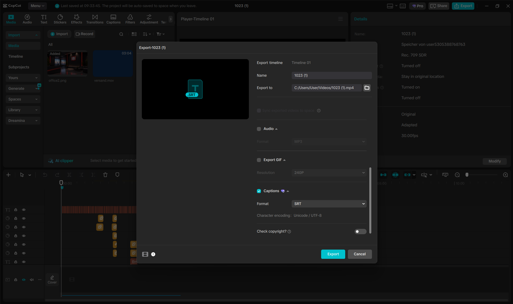
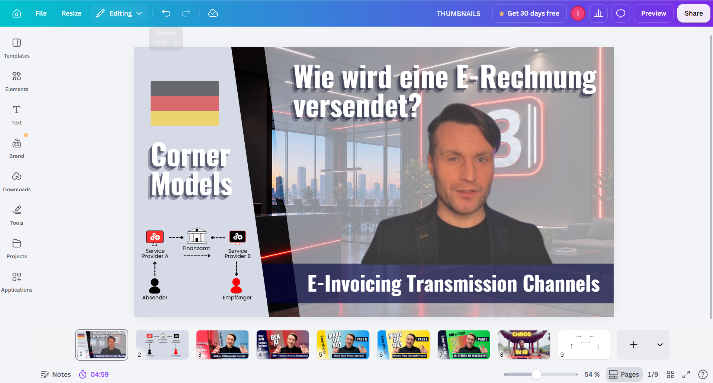
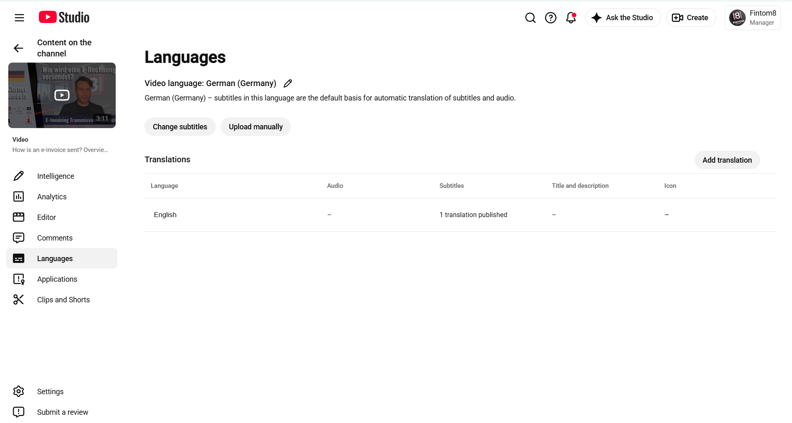

# Tutorials Creation Process

## Step 1: Topic and Prompt
Find an interesting topic from the source. Create an informative and factual text based on it that can be read in 90 seconds or less. To do this, use AI with a prompts like **"Write a script for a 90 seconds video, without any directorial decisions and based on this source, for people who don't know whaat this is"**, in German, and then be sure to edit it yourself.

## Step 2: Record the Video
Record a video where a person reads the text clearly and expressively. In our case, we used Igor Nikolaienko, who presented the information in the video.

## Step 3: Edit the Video in CapCut
Next, we open **CapCut** and remove the background from the original video. Then, we add our own background, which is an office background generated with AI.

## Step 4: Edit the Audio
After that, we separate the audio from the video. We also add quiet background music to make the tutorial more professional without distracting viewers from the speaker.

## Step 5: Add Animations and Text
Next, we add animations and text to the video to make the tutorial more interesting and easier to understand. This should be a simple animation where something appears, created in **Canva** or **CapCut** (example: a step-by-step visualization of a model).

## Step 6: Add Subtitles
Subtitles are also very important. CapCut automatically generates subtitles and synchronizes them well with the audio, but the text is not always accurate. Therefore, we keep the original subtitle timing and replace the generated text with our own correct script.

## Step 7: Export the Video and Subtitle File
We export the finished video and the subtitle file in **SRT format**. Usually, versions of the video with and without subtitles are required, along with an srt file in German and English languages, we translate the srt file using AI. Then, we upload both files to Google Drive so they can be accessed and shared easily.

## Step 8: Create a thumbnail (preview)
In **Canva**, create a version featuring a charecter, an office background, the topic title, and stylized design. Save it as JPG.

## Step 9: Create a LinkedIn post
Translate the text into English, adding design elements such as icons and emojis (not too many), and be sure to include a call-to-action/hook linking back to a previous post/tutorial/comment at the end. Then include a link to our YouTube channel, hashtags, and attach our finished video - make sure it has subtitles. Schedule the post.

## Step 10: Uploading a video to YouTube
Go to YouTube Studio, click **"Create"**, upload the video (no embedded subtitls), enter a titel in German/English, and use the text from our LinkedIn post (including hashtags) - as the description. Upload a thumbnail (preview), and set the audience to **"Not for children"**. For subtitles, upload an srt file. First, upload the subtitles in the original language. After saving the finished video, go to the **"Languages"** section for this video, add a new language, and upload the corresponding srt file there. 

The end screen should feature the previous video and the channel logo in the upper corners of the screen. Publish the video to everyone and ask the team to engage with it (like and comment).

---

!!! info "Tip for CapCut co-work"
    While working in CapCut, you can collaborate on different parts of a video.

    To do this, all participants must first log in to a shared Cursor account and then switch to that account in CapCut. In the **"Spaces"** section, you’ll see shared projects.

    - Only one person at a time can upload changes for everyone when closing the project.
    - Compatibility issues may arise if you upload changes simultaneously or make changes  without first pulling in previous changes.
    - Therefore, only one person should make changes at a time; the others should create elements that can be copied via **“My Presets.”**
    - When a preset is ready, select it and save it as a preset, which can then be imported into the “My Presets” folder.