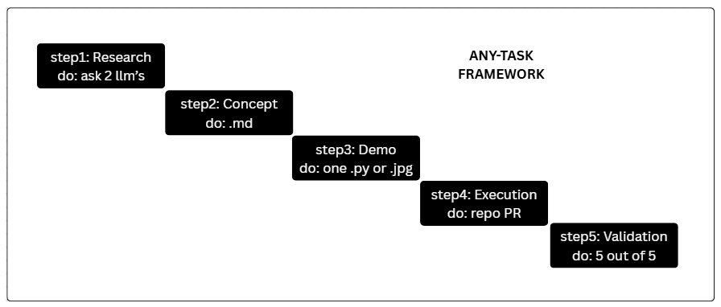
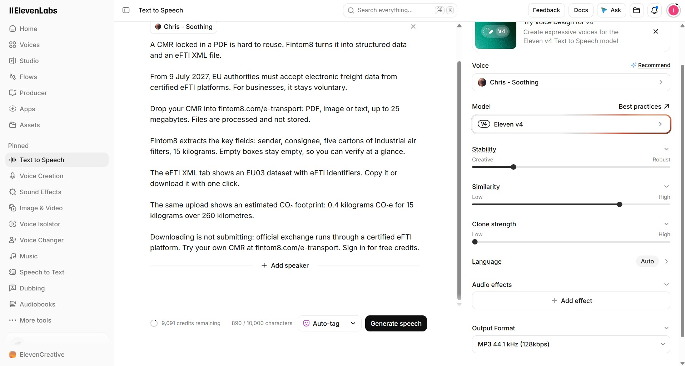
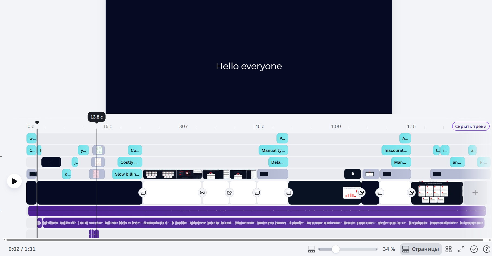

# Video Creation Process

## The main algorithm of our work

## Step 1: Preparation

Every video starts with research. Search for source material and collect references that match the result you want to achieve. Decide on the video’s length and purpose up front: is it a tutorial, or a presentation of new features? Then organize the collected material by consulting at least two LLMs, so you can compare their structures and pick the strongest one.

## Step 2: Writing the Script

Begin by outlining the video’s structure: the name of each stage and what will be demonstrated in it. Use LLMs to organize your material according to this structure, and state the purpose and approximate duration in the prompt. Write one short paragraph per stage, concise and factual. Ideally, each stage ends with bullet points that highlight the key benefits for the viewer. Once the draft is ready, edit the text again, come up with a title, and mark the words you want to feature visually in the video.

!!! info "Script structur example"
    Problem —\> Solution —\> "3 points" —\> 1\. Demo —\> "3 points" —\> 2\. Demo —\> "3 points" —\> End (link)

## Step 3: Creating a Demo in Canva

Create a new video project in Canva and add the main elements of the demo: photos, screen recordings, the generated voiceover, and soft background music. Use a monotonous background track as the base layer, where text and animations will appear. Create animated text and synchronize it with the voiceover, adding animations in places to keep the narrative lively. Then give everything a consistent look, add transitions and an ending. Finally, create the thumbnail in a separate Canva project dedicated to YouTube thumbnails, reusing the background and text from the video.

## Creating an AI text-to-speech recording

[ElevenLabs](https\://elevenlabs.io/app/speech-synthesis/text-to-speech)

Follow the link, sign up, and create a new **"Speech"**. In the **"Voice"** settings, select a narrator’s voice (**Chris-Soothing (US)** is a good option). Paste the text you want to have read aloud and generate the speech. If you’re not satisfied with the result, adjust the **"Stability"** setting.

## Creating animations
1. **Choose the text.** Select the part of your video script that you want to illustrate with an animation.

2. **Describe the animation** in Google AI Studio. Write a prompt explaining what you want the animation to show. Include the visual style, movements, duration (4–10 seconds), and background. Keep the animation simple and consistent with your video's design. You can also add a reference image to show the desired colours and style.

3. Set the technical settings. Use the following settings:
    - **Format:** 2D animation (flat, simple graphics) or 3D animation (if you need more motion graphics and realistic 3D objects).
    - **Aspect ratio:** 16:9.
    - **Resolution:** 1920 × 1080 (Full HD) or 1280 × 720 (HD).
    - **Background:** Transparent, if supported, or matching the background of your video.
    - **Export formats:** WebM or MP4.
4. **Generate the animation.** Use an AI video generation tool that supports animation creation (like Claude, Gemini). Enter your prompt, upload your reference image if available, and generate the animation. Check that the movements are smooth and that the animation matches the text in your video.

!!! info "Why save in WebM or MP4?"
      - WebM: Often supports transparent backgrounds (alpha channel). This makes it useful for animations that you want to place over other video layers in Canva without a visible background.
     - MP4: Works with most video editors and platforms, including Canva. It is a good choice for animations with a solid background.

!!! danger "Important"
     MP4 generally does not support transparency. If you need a transparent animation, use WebM.

## Step 4: Review and Finalization

Once everything looks good, ask a colleague to review the work and make any necessary adjustments. Then download the video and the thumbnail (as a JPEG) from the **"Share"** tab in Canva and upload them to YouTube.

---

Final examples:

[https\://www\.youtube.com/watch?v=gHWuh99f\_14](https://www.youtube.com/watch?v=gHWuh99f_14)

[https\://www\.youtube.com/watch?v=M81bqM5jpNc](https://www.youtube.com/watch?v=M81bqM5jpNc)

